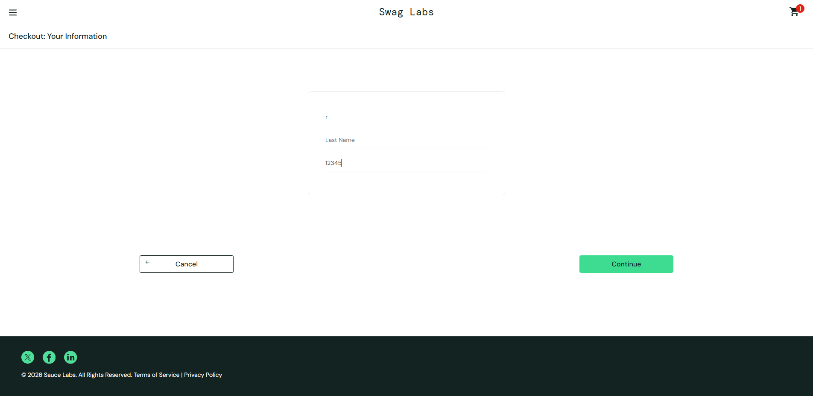

# BUG-CHECKOUT-001 - Typing Last Name overwrites First Name and blocks checkout

**Tracking:** [GitHub issue](https://github.com/CodecoolGlobal/test-automation-webshop-in-beta-general-memyselfandi-3003/issues/18)

**Defect ID:** BUG-CHECKOUT-001
**Status:** Reproduced; open application defect.
**Affected accounts:** problem_user
**Suggested severity:** High

## Environment and preconditions

Verified on 18 November 2026 at https://www.saucedemo.com/ using Chrome 158.0.8127.36 on Windows, headless, window 1920 × 1080 (content viewport 1904 × 929). Start a fresh browser session. Use the valid demo password displayed on the application's login page; do not include it in this ticket.

## Steps to reproduce

1. Sign in as problem_user, add Sauce Labs Backpack, open the cart and select Checkout.
2. Enter Alex in First Name.
3. Type Tester in Last Name, then enter 12345 in Postal Code.
4. Inspect all fields and select Continue.

## Expected result

Each field should retain its own entered value, and complete customer information should allow checkout to advance.

## Actual result

After typing Last Name, First Name changes from Alex to r and Last Name remains empty. Postal Code retains 12345. Continue stays on checkout-step-one.html and shows Error: Last Name is required.

## Impact

Normal customer-information entry cannot complete checkout.

## Evidence and scope

Reproduced with a temporary Selenium diagnostic run on 18 November 2026. These observations are separate from the 23-execution JUnit suite; no new automated case is implied. Structured evidence is retained in the repository under [structured evidence](../evidence/2026-11-18/rechecks.json). Screenshot: `checkout-information-problem_user.png` in the same directory.

Adding this report does not fix the external application. Keep this issue open until the behavior is corrected and retested.

