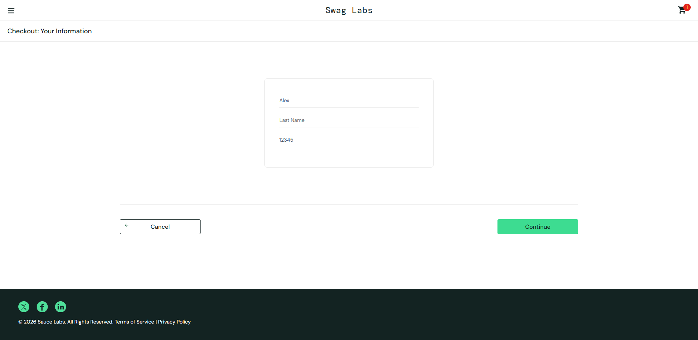

# BUG-CHECKOUT-002 - Last Name discards input while checkout advances

**Tracking:** [GitHub issue](https://github.com/CodecoolGlobal/test-automation-webshop-in-beta-general-memyselfandi-3003/issues/19)

**Defect ID:** BUG-CHECKOUT-002
**Status:** Reproduced; open application defect.
**Affected accounts:** error_user
**Suggested severity:** Medium

## Environment and preconditions

Verified on 18 November 2026 at https://www.saucedemo.com/ using Chrome 158.0.8127.36 on Windows, headless, window 1920 × 1080 (content viewport 1904 × 929). Start a fresh browser session. Use the valid demo password displayed on the application's login page; do not include it in this ticket.

## Steps to reproduce

1. Sign in as error_user, add Sauce Labs Backpack, open the cart and select Checkout.
2. Enter Alex in First Name, type Tester in Last Name and enter 12345 in Postal Code.
3. Inspect the fields and select Continue.

## Expected result

The Last Name input should retain the text typed into it; the customer information used by checkout should match the input.

## Actual result

Last Name is enabled but remains empty after typing Tester. First Name stays Alex and Postal Code stays 12345. Continue nevertheless opens checkout-step-two.html. The input loss is the confirmed defect; advancement with an empty name is recorded separately as observed behavior.

## Impact

Customer information is silently lost before order review.

## Evidence and scope

Reproduced with a temporary Selenium diagnostic run on 18 November 2026. These observations are separate from the 23-execution JUnit suite; no new automated case is implied. Structured evidence is retained in the repository under [structured evidence](../evidence/2026-11-18/rechecks.json). Screenshot: `checkout-information-error_user.png` in the same directory.

Adding this report does not fix the external application. Keep this issue open until the behavior is corrected and retested.

