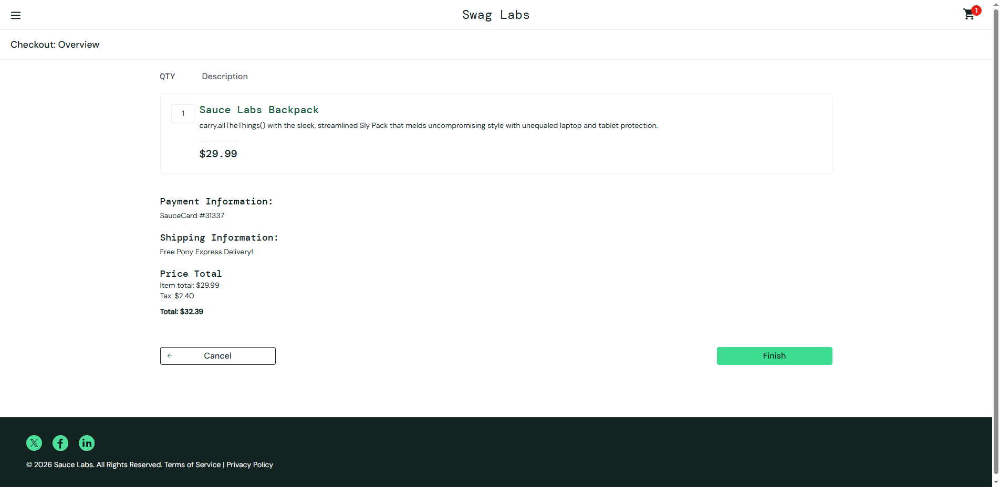

# BUG-CHECKOUT-003 - Finish leaves error_user on order review without feedback

**Tracking:** [GitHub issue](https://github.com/CodecoolGlobal/test-automation-webshop-in-beta-general-memyselfandi-3003/issues/20)

**Defect ID:** BUG-CHECKOUT-003
**Status:** Reproduced; open application defect.
**Affected accounts:** error_user
**Suggested severity:** High

## Environment and preconditions

Verified on 18 November 2026 at https://www.saucedemo.com/ using Chrome 158.0.8127.36 on Windows, headless, window 1920 × 1080 (content viewport 1904 × 929). Start a fresh browser session. Use the valid demo password displayed on the application's login page; do not include it in this ticket.

## Steps to reproduce

1. Sign in as error_user, add Sauce Labs Backpack and start Checkout.
2. Enter First Name Alex, attempt Last Name Tester and enter Postal Code 12345. Last Name remains empty (a separate confirmed defect), but the application allows Continue.
3. Select Continue and confirm the order overview contains Backpack.
4. Select the enabled Finish button and observe the page for at least five seconds.

## Expected result

Finish should complete an accepted order and display confirmation, or show actionable validation if the supplied information prevents completion.

## Actual result

No alert or confirmation appears. After five seconds the URL remains /checkout-step-two.html and Finish is still visible. The same sample flow completed for standard_user and visual_user. This report does not claim that error_user retained a valid Last Name.

## Impact

The accepted checkout flow silently stops at its final action. The screenshot shows the overview immediately before Finish; the recorded post-click state is in the structured evidence.

## Evidence and scope

Reproduced with a temporary Selenium diagnostic run on 18 November 2026. These observations are separate from the 23-execution JUnit suite; no new automated case is implied. Structured evidence is retained in the repository under [structured evidence](../evidence/2026-11-18/rechecks.json). Screenshot: `checkout-overview-error_user.png` in the same directory.

Adding this report does not fix the external application. Keep this issue open until the behavior is corrected and retested.

