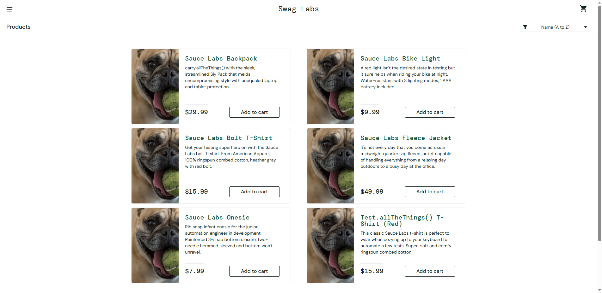

# BUG-IMAGE-001 - Catalog displays a dog image instead of product photographs

**Tracking:** [GitHub issue](https://github.com/CodecoolGlobal/test-automation-webshop-in-beta-general-memyselfandi-3003/issues/11)

**Defect ID:** BUG-IMAGE-001
**Status:** Reproduced; open application defect.
**Affected accounts:** problem_user, visual_user
**Suggested severity:** Medium

## Environment and preconditions

Verified on 18 November 2026 at https://www.saucedemo.com/ using Chrome 158.0.8127.36 on Windows, headless, window 1920 × 1080 (content viewport 1904 × 929). Start a fresh browser session. Use the valid demo password displayed on the application's login page; do not include it in this ticket.

## Steps to reproduce

1. Sign in as problem_user and open Products.
2. Inspect the photographs of all six products.
3. Repeat in a fresh session as visual_user and inspect Sauce Labs Backpack.
4. Compare with standard_user in a fresh session.

## Expected result

Each product should display its corresponding product photograph.

## Actual result

problem_user displays the same dog photograph for all six products. visual_user displays that photograph for Backpack. The incorrect asset is sl-404-Cq1a9k9X.jpg; standard_user displays the Backpack photograph and six distinct product images.

## Impact

Customers cannot reliably identify products from their images.

## Evidence and scope

Reproduced with a temporary Selenium diagnostic run on 18 November 2026. These observations are separate from the 23-execution JUnit suite; no new automated case is implied. Structured evidence is retained in the repository under [structured evidence](../evidence/2026-11-18/rechecks.json). Screenshot: `catalog-problem_user.png` in the same directory.

Adding this report does not fix the external application. Keep this issue open until the behavior is corrected and retested.

