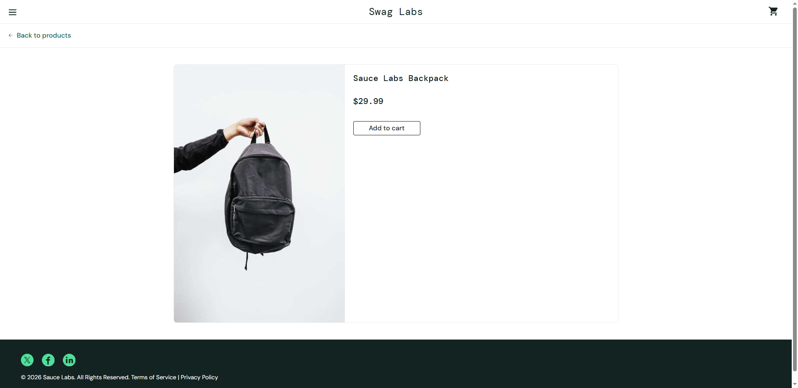

# BUG-PRODUCT-002 - Backpack details omit the product description for error_user

**Tracking:** [GitHub issue](https://github.com/CodecoolGlobal/test-automation-webshop-in-beta-general-memyselfandi-3003/issues/15)

**Defect ID:** BUG-PRODUCT-002
**Status:** Reproduced; open application defect.
**Affected accounts:** error_user
**Suggested severity:** Medium

## Environment and preconditions

Verified on 18 November 2026 at https://www.saucedemo.com/ using Chrome 158.0.8127.36 on Windows, headless, window 1920 × 1080 (content viewport 1904 × 929). Start a fresh browser session. Use the valid demo password displayed on the application's login page; do not include it in this ticket.

## Steps to reproduce

1. Sign in as error_user.
2. Navigate to https://www.saucedemo.com/inventory-item.html?id=4.
3. Inspect the content between the Backpack name and price.

## Expected result

Backpack details should include the product description, as on the standard-user product page.

## Actual result

The name, image, $29.99 price and Add to cart are present, but the description is absent. There are zero .inventory_details_desc elements; visible page text also contains no description.

## Impact

Product information is incomplete. A page-load wait requiring the description cannot complete.

## Evidence and scope

Reproduced with a temporary Selenium diagnostic run on 18 November 2026. These observations are separate from the 23-execution JUnit suite; no new automated case is implied. Structured evidence is retained in the repository under [structured evidence](../evidence/2026-11-18/rechecks.json). Screenshot: `details-error_user-backpack.png` in the same directory.

Adding this report does not fix the external application. Keep this issue open until the behavior is corrected and retested.

