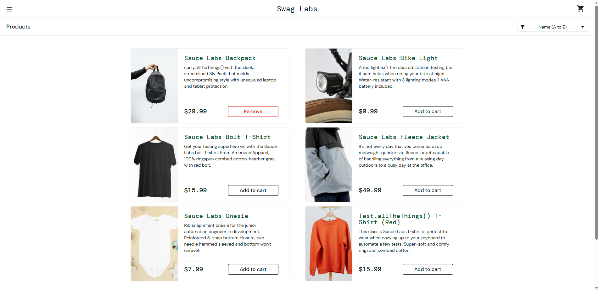

# BUG-RESET-001 - Reset App State empties the cart but leaves Remove buttons

**Tracking:** [GitHub issue](https://github.com/CodecoolGlobal/test-automation-webshop-in-beta-general-memyselfandi-3003/issues/10)

**Defect ID:** BUG-RESET-001
**Status:** Reproduced; open application defect.
**Affected accounts:** standard_user, problem_user, error_user, visual_user, performance_glitch_user
**Suggested severity:** Low

## Environment and preconditions

Verified on 18 November 2026 at https://www.saucedemo.com/ using Chrome 158.0.8127.36 on Windows, headless, window 1920 × 1080 (content viewport 1904 × 929). Start a fresh browser session. Use the valid demo password displayed on the application's login page; do not include it in this ticket.

## Steps to reproduce

1. Sign in as standard_user.
2. Add Sauce Labs Backpack to the cart; confirm the badge is 1 and its button says Remove.
3. Open the menu, select Reset App State, then close the menu.
4. Inspect the Backpack button and cart badge, then refresh the page.

## Expected result

Reset should clear the cart and restore Add to cart immediately.

## Actual result

The cart badge disappears, but Backpack still shows Remove. Refreshing restores Add to cart. The same sequence reproduced for all five listed accounts.

## Impact

Reset controls disagree with the actual cart until refresh.

## Evidence and scope

Reproduced with a temporary Selenium diagnostic run on 18 November 2026. These observations are separate from the 23-execution JUnit suite; no new automated case is implied. Structured evidence is retained in the repository under [structured evidence](../evidence/2026-11-18/rechecks.json). Screenshot: `reset-standard_user.png` in the same directory.

Adding this report does not fix the external application. Keep this issue open until the behavior is corrected and retested.

