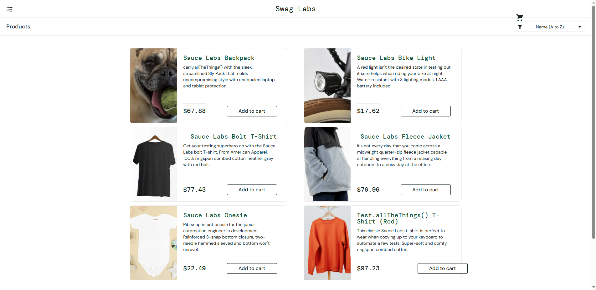

# BUG-VISUAL-001 - Cart icon is displaced from its header position

**Tracking:** [GitHub issue](https://github.com/CodecoolGlobal/test-automation-webshop-in-beta-general-memyselfandi-3003/issues/22)

**Defect ID:** BUG-VISUAL-001
**Status:** Reproduced; open application defect.
**Affected accounts:** visual_user
**Suggested severity:** Low

## Environment and preconditions

Verified on 18 November 2026 at https://www.saucedemo.com/ using Chrome 158.0.8127.36 on Windows, headless, window 1920 × 1080 (content viewport 1904 × 929). Start a fresh browser session. Use the valid demo password displayed on the application's login page; do not include it in this ticket.

## Steps to reproduce

1. Use Chrome with a 1920 × 1080 window (recorded content viewport 1904 × 929).
2. Sign in as visual_user and open Products.
3. Inspect the cart icon's position relative to the top header and Products row.
4. Compare with standard_user at the same dimensions in a fresh session.

## Expected result

The cart icon should remain aligned within the top-right header.

## Actual result

The icon is shifted left and down toward the Products row. Recorded link bounds: visual_user x=1642,y=38,w=40,h=40; standard_user x=1829,y=10,w=40,h=40. Displacement was also visible on checkout pages.

## Impact

The main navigation control is visually misplaced. Coordinates describe the observed run, not a fixed product requirement.

## Evidence and scope

Reproduced with a temporary Selenium diagnostic run on 18 November 2026. These observations are separate from the 23-execution JUnit suite; no new automated case is implied. Structured evidence is retained in the repository under [structured evidence](../evidence/2026-11-18/rechecks.json). Screenshot: `layout-visual_user.png` in the same directory.

Adding this report does not fix the external application. Keep this issue open until the behavior is corrected and retested.

