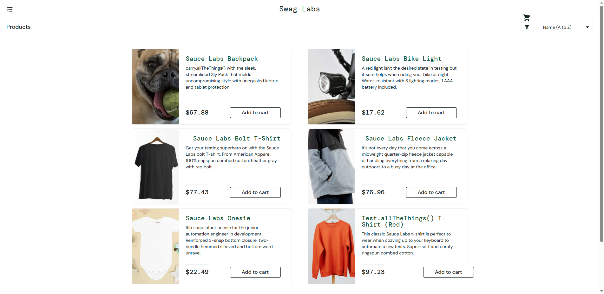

# BUG-VISUAL-002 - Red T-shirt Add to cart button protrudes beyond its card

**Tracking:** [GitHub issue](https://github.com/CodecoolGlobal/test-automation-webshop-in-beta-general-memyselfandi-3003/issues/23)

**Defect ID:** BUG-VISUAL-002
**Status:** Reproduced; open application defect.
**Affected accounts:** visual_user
**Suggested severity:** Low

## Environment and preconditions

Verified on 18 November 2026 at https://www.saucedemo.com/ using Chrome 158.0.8127.36 on Windows, headless, window 1920 × 1080 (content viewport 1904 × 929). Start a fresh browser session. Use the valid demo password displayed on the application's login page; do not include it in this ticket.

## Steps to reproduce

1. Use Chrome with a 1920 × 1080 window (recorded content viewport 1904 × 929).
2. Sign in as visual_user and open Products.
3. Inspect the Add to cart button on Test.allTheThings() T-Shirt (Red), the last card. If a rendering differs, reload and record it.
4. Compare with standard_user at the same dimensions.

## Expected result

The button should be contained within its product card with consistent alignment.

## Actual result

In the recorded rendering the card spans x=969 to 1474 and its button spans x=1333 to 1493: the button protrudes 19 pixels to the right. The standard-user button is contained within its card. Placement may vary between visual-user renderings; this is an observed layout defect at the recorded viewport.

## Impact

The action extends beyond its product container and breaks alignment.

## Evidence and scope

Reproduced with a temporary Selenium diagnostic run on 18 November 2026. These observations are separate from the 23-execution JUnit suite; no new automated case is implied. Structured evidence is retained in the repository under [structured evidence](../evidence/2026-11-18/rechecks.json). Screenshot: `layout-visual_user.png` in the same directory.

Adding this report does not fix the external application. Keep this issue open until the behavior is corrected and retested.

